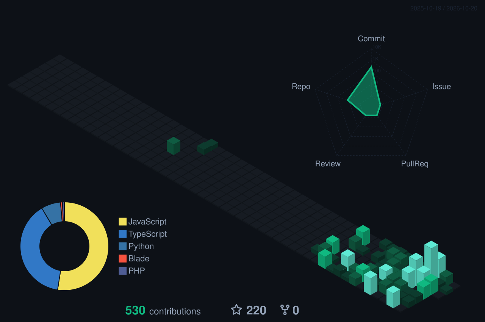

<!--
  Muhammad Saad — GitHub Profile README
  Theme: Deep teal/emerald dark tech — Accent #10b981 / #2dd4bf on #0d1117
  Auto-generated assets: profile-3d-contrib/ (3D graph), github-metrics.svg (analytics), output branch (snake) via GitHub Actions
-->

  

  

  

  <em>Building production-style web apps with the MERN stack.</em>

  

  
  
  

  

---

## ⚡ About Me

- 💻 Full stack developer working mainly in the **MERN stack** | React, Node.js, Express, MongoDB, Next
- 🎓 Advanced Diploma in Software Engineering | **Aptech**, Karachi
- 🚀 Currently working on Palettero - an AI-based color utility tool (Next.js, Tailwind CSS, Supabase)
- 🎯 Prefer shipping something small end-to-end over half-finishing something impressive
- 📡 Comfortable across the stack - from REST APIs to responsive frontends

---

## 🌐 Socials:
    

---

## 💻 Tech Stack

### 🌐 Languages

### 🚀 Frameworks & Libraries

### 🛢️ Databases & Cloud Services

### ⚙️ DevOps, Hosting & Tools

---

## 🚀 Featured Projects

  
  
  
  
    
  </a>
    

---

## 🔥 GitHub Analytics

 
 

---

## 🧊 3D Contribution Graph

  

Auto-generated nightly by <code>.github/workflows/3d-contrib.yml</code>

---

## 🐍 Contribution Snake

  

Auto-generated on push by <code>.github/workflows/snake.yml</code>

---

## ⚙️ What I'm Building

- 🗓️ **Palettero** | an AI-based color utility tool for designer and developers
- 🧾 **POS System** | a MERN-based point-of-sale app for handling sales, inventory, and receipts

---

## 🧬 Philosophy

> **Execution Over Words.**
>
> *"Code is a liability until it solves someone's actual problem."*

  

---

  

  

