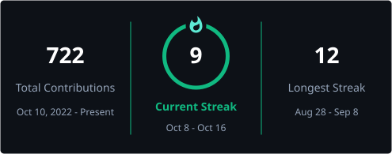

<!--
  Muhammad Saad - GitHub Profile README
  Theme: matches LinkedIn banner. Background #030A10 to #07161A, accent #00E8B8, secondary #08C8A0, text #FFFFFF
  Assets in ./assets: banner.png (same file as LinkedIn banner), dp.png (circular profile photo)
  Auto-generated: github-metrics.svg, streak-stats.svg, profile-3d-contrib/, snake (output branch)
-->

  

  

  

  
  
  

  

---

## About

- Full stack developer working mainly in the **MERN stack**: React, Node.js, Express, MongoDB
- Advanced Diploma in Software Engineering at **Aptech**, Karachi
- Built **EventSphere**, a multi-role Event & Expo Management SaaS, and a **MERN-based POS System**
- I prefer shipping something small end to end over half-finishing something impressive
- Comfortable across the stack, from REST APIs to responsive frontends

---

## Tech Stack

  

  
  
  

---

## Featured Projects

  
  

---

## What I'm Building

- **EventSphere**: a full-stack MERN platform for managing events and expos across organizer, exhibitor, and attendee roles
- **POS System**: a MERN-based point-of-sale app for handling sales, inventory, and receipts

---

## GitHub Analytics

  

  

Metrics and streak stats are generated daily at midnight UTC by <code>.github/workflows/metrics.yml</code> and <code>.github/workflows/streak-stats.yml</code>.

---

## 3D Contribution Graph

  

---

## Contribution Snake

  

---

## Philosophy

> **Execution over words.**
>
> Code is a liability until it solves someone's actual problem.

---

  

